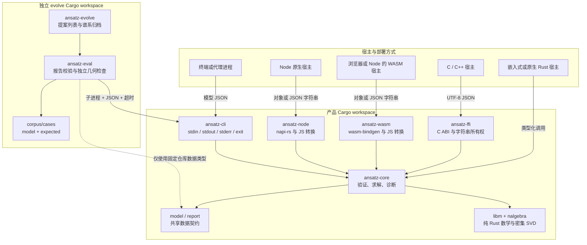
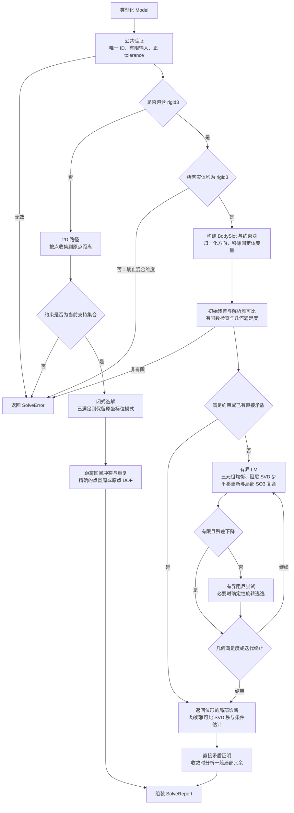
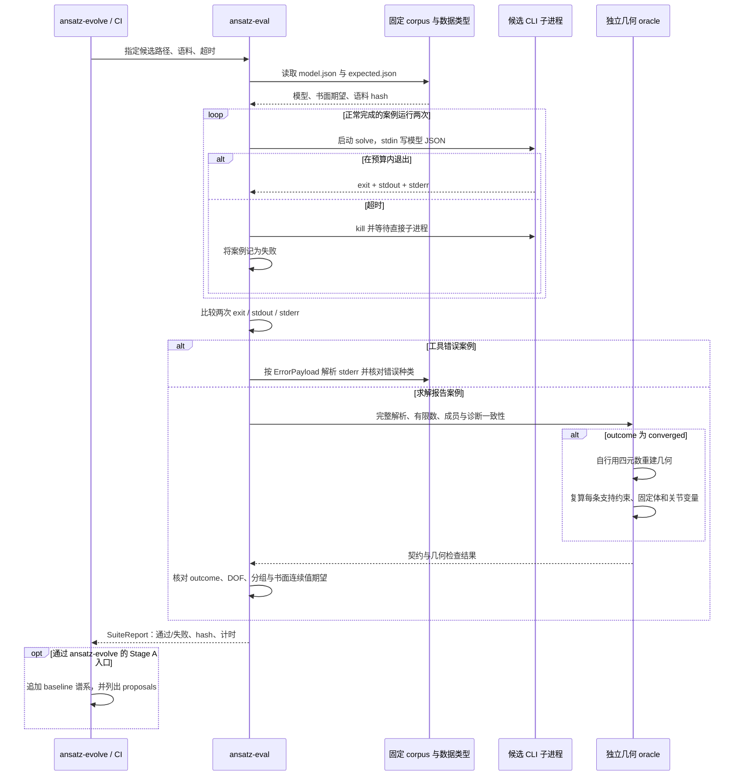

# Ansatz 架构

本文记录 **0.4.0 / `main`，提交 `51d18d4`** 的已实现架构，核对日期为 **2026-10-13**。源码是实现事实的依据；本文中的未来职责不表示已有模块。产品入口见 [README](../README.md)，决策依据见 [ADR 索引](adr/README.md)，阶段目标与验收条件见 [演进路线图](roadmap.md)。

## 1. 系统边界与依赖

Ansatz 将数值求解集中在一个 Rust 核心中，外壳负责宿主数据转换、序列化和错误映射。产品 workspace 的成员只有 `crates/*`；`evolve/` 是另一个 Cargo workspace。实验依赖不会进入产品构建，评测器通过 CLI 子进程调用候选程序。



图中的实线表示调用或依赖，虚线强调评测器只复用固定仓库的数据类型。候选程序可以是另一个构建产物；评测器不会加载候选的求解代码。底层 `ansatz-core` crate 虽作为类型依赖存在，几何 oracle 不调用它的求解器、残差、SO(3) 或线性代数函数。

核心默认配置为 `#![no_std]` + `alloc`，且 `forbid(unsafe_code)`。`serde` 是可选序列化功能；`schema` 功能会引入依赖 `std` 的 schemars，仅供宿主侧导出契约。因而“纯 `no_std` 核心”指算法与默认构建路径，并不表示启用所有功能后仍无 `std`。WASM CI 用 `--no-default-features` 单独检查这条边界。

### 模块责任与定位

以下链接相对于本文，可直接追踪实现及其主要验证。

| 模块 | 责任 | 源码与验证入口 |
|---|---|---|
| `ansatz-core::model` | 实体、约束、求解参数、几何局部数据与 serde/schema 类型 | [model.rs](../crates/ansatz-core/src/model.rs)、[model schema](../schema/model.schema.json) |
| `ansatz-core::report` | 三种 outcome、DOF/冲突/冗余/残差/关节状态、建议、工具错误及 Envelope | [report.rs](../crates/ansatz-core/src/report.rs)、[report schema](../schema/solve-report.schema.json) |
| `ansatz-core::solver` | 公共 `solve`、结构和有限数校验、分流、点到原点的 2D 闭式解 | [solver.rs](../crates/ansatz-core/src/solver.rs)、[solve_test.rs](../crates/ansatz-core/tests/solve_test.rs)、[input_validation_test.rs](../crates/ansatz-core/tests/input_validation_test.rs) |
| `ansatz-core::assembly` | 刚体参数布局、约束块、解析雅可比、LM、关节测量与局部诊断 | [assembly.rs](../crates/ansatz-core/src/assembly.rs)、[assembly_test.rs](../crates/ansatz-core/tests/assembly_test.rs)、[robot_test.rs](../crates/ansatz-core/tests/robot_test.rs) |
| `ansatz-core::so3` | Rodrigues 旋转、局部旋转增量复合、确定性三维运算 | [so3.rs](../crates/ansatz-core/src/so3.rs)、[regression_test.rs](../crates/ansatz-core/tests/regression_test.rs) |
| `ansatz-core::linalg` | 平移/旋转列三元组均衡、有界 SVD、阻尼伪逆、秩与条件估计 | [linalg.rs](../crates/ansatz-core/src/linalg.rs)，包括模块内预算和有限数测试 |
| `ansatz-ffi` | C ABI、UTF-8 JSON、错误信封及返回字符串回收 | [lib.rs](../crates/ansatz-ffi/src/lib.rs)、[ansatz.h](../crates/ansatz-ffi/include/ansatz.h)、[ffi_smoke.py](../crates/ansatz-ffi/smoke/ffi_smoke.py) |
| `ansatz-wasm` | JS 对象/字符串转换、单线程 WASM、npm 包 | [lib.rs](../crates/ansatz-wasm/src/lib.rs)、[类型声明](../crates/ansatz-wasm/types/ansatz.d.ts)、[node smoke](../crates/ansatz-wasm/smoke/node.mjs) |
| `ansatz-node` | napi-rs 原生 JS 对象/字符串 API | [lib.rs](../crates/ansatz-node/src/lib.rs)、[native smoke](../crates/ansatz-node/smoke/native.mjs) |
| `ansatz-cli` | stdin JSON、stdout 报告、stderr 错误、退出码、Schema 导出 | [main.rs](../crates/ansatz-cli/src/main.rs)、[cli.rs](../crates/ansatz-cli/tests/cli.rs) |
| `ansatz-eval` | 语料加载、候选子进程、超时、重复输出和期望断言 | [lib.rs](../evolve/crates/evaluator/src/lib.rs)、[main.rs](../evolve/crates/evaluator/src/main.rs) |
| 独立几何 oracle | 完整报告契约、模型成员、固定体、支持约束与关节变量的独立复算 | [geometry_check.rs](../evolve/crates/evaluator/src/geometry_check.rs)、[geometry_oracle.rs](../evolve/crates/evaluator/tests/geometry_oracle.rs) |
| `ansatz-evolve` | `Proposer`/`Selector` 抽象、手动提案扫描、追加 JSONL 谱系 | [lib.rs](../evolve/crates/harness/src/lib.rs)、[main.rs](../evolve/crates/harness/src/main.rs) |
| 数值跨平台验证 | 固定输入的十六进制 f64 期望、回灌和 JSON 往返幂等 | [parity_test.rs](../crates/ansatz-core/tests/parity_test.rs)、[parity fixtures](../crates/ansatz-core/tests/parity/) |

## 2. API 与错误契约

类型化 Rust API 为 `solve(&Model) -> Result<SolveReport, SolveError>`。`Ok(report)` 包括 `converged`、`inconsistent` 和 `not_converged`；后两种仍是求解层结论。`Err` 表示模型无效、未知实体或当前不支持的能力。

| 调用入口 | 输入 | 输出与宿主边界 |
|---|---|---|
| C `ansatz_solve_json` | NUL 结尾 UTF-8 JSON 文本 | JSON 文本 Envelope；返回字符串必须用 `ansatz_string_free` 释放；`ansatz_version` 返回静态字符串 |
| WASM / Node `solveJson` | 模型 JSON 字符串 | JSON 字符串 Envelope |
| WASM / Node `solve` | 符合模型契约的 JS 对象 | JS 对象 Envelope；使用与文本 API 相同的核心结果及错误分类 |
| CLI `solve` | stdin 模型 JSON | 成功执行求解时 stdout 为裸 `SolveReport`；工具错误写 stderr |

FFI、WASM 和 Node 共用 `report.rs` 中的信封形状：

```text
{"ok":true,"result":<SolveReport>}
```

```json
{"ok":false,"error":{"kind":"invalid_model","message":"..."}}
```

上面的 `<SolveReport>` 表示符合完整契约的报告对象。`ok` 表示调用是否获得求解报告，**不表示几何是否求解成功**；`result.outcome = "inconsistent"` 仍使用 `ok:true`。JS 的结构化入口和文本入口是两种编码方式，不是两套数学实现。

CLI 不套 Envelope，其业务退出码契约如下。自动化消费者必须同时读取退出码和对应输出流。

| 退出码 | 含义 | 输出 |
|---|---|---|
| `0` | 返回位形满足约束，`converged` | stdout：完整 `SolveReport` |
| `1` | `inconsistent` 或 `not_converged` | stdout：完整 `SolveReport` 和诊断 |
| `2` | 工具错误，例如 `invalid_json`、`invalid_model`、`unsupported_constraint` | stderr：`{"kind":"...","message":"..."}`，即工具错误负载；stdout 无求解报告 |

这里的工具错误负载由共享 `ErrorPayload` 描述，CLI 自身还可能产生 `io_error`、`serialization`。C ABI 的 solve/free 边界拦截 Rust unwind；宿主仍须遵守有效指针与字符串所有权契约。

## 3. 一次 solve 的内部流程



### 3D 数值路径

每个自由刚体有六个局部优化自由度：三平移、三旋转。固定体从变量布局移除；JSON 姿态仍用旋转向量。更新使用 `R_new = R * exp(delta_rotation)` 的局部 SO(3) 复合，避免将全局旋转向量坐标奇异直接当成物理 DOF。零增量保留输入位模式，已满足输入不做额外重投影。

约束残差与解析雅可比按确定顺序组装。LM 步与诊断使用同一类列尺度均衡：每个平移或旋转三元组共享该组最大绝对系数，既均衡长度/旋转尺度，又保持三维方向内的相对度量。SVD 秩阈值为 `sigma_i > sigma_max * 1e-10`，作用于均衡后的局部雅可比。条件估计是非零奇异值的比值，不是原始物理量矩阵的无条件全局稳定性保证。

外层 LM 受 `params.max_iterations` 限制；每轮阻尼试步最多八次，旋转逃逸也是有限次确定性尝试。每次 SVD 自身另有 **4096** 的非零迭代预算，避免将库的零预算解释成无限迭代。输入、初始残差/雅可比、分解与步长均有有限数检查；非有限试步被拒绝。预算耗尽或不能可靠表示的数值由当前契约映射为 `invalid_model`，没有独立的 `numeric_failure` 错误类型。

角度折回使用有界 `libm::fmod`，而非反复减去 `2π`；巨大有限 drive 不会困在浮点值不再变化的循环。传动也先处理周期量，检查乘积的有限性。默认参数是 `tolerance = 1e-9`、`max_iterations = 100`。

### 约束语义对残差与 DOF 的影响

| 约束或边界 | 当前实现语义 |
|---|---|
| `angle` | 先归一化非零方向；几何满足度按实际弧度误差检查。精确 `0`、`π` 使用方向相等/相反的向量残差，在常规相对姿态消去两个旋转 DOF；中间角通常消去一个 |
| 正 3D `distance` | 比较两体局部锚点经姿态变换后的距离；锚点重合初值选择确定性单侧方向以逃离零梯度 |
| 零 3D `distance` | 表示锚点重合，采用三维位置差约束，常规情况下消去三个位置 DOF |
| `coaxial` 与轴关节 | 轴线位置相合且方向同向；反平行轴不能以零叉积冒充满足 |
| `mate` | 两平面接触且法向相反；常规情况下保留面内两平移和绕法向旋转 |
| `revolute` / `cylindrical` | 同轴基础上的旋转/轴移语义；旋转零位由体局部参考方向定义，drive 是绝对角目标 |
| `prismatic` | 同轴并锁定滚转；`a_ref`、`b_ref`、`roll` 必须同时提供，或同时省略并采用确定性参考和零滚转；drive 约束绝对轴向距离 |
| `spherical` | 两个局部锚点在世界坐标重合 |
| `transmission` | 两个不同转动副之间 `theta_b = ratio * theta_a`，按 `2π` 周期比较；连续未折回相位尚未实现 |
| 2D 点到原点距离 | 正距离留下圆周上的一个 DOF，零距离固定在原点并留下零 DOF；只实现此闭式子集 |

表中的消去数描述非退化的典型相对运动，不能按约束数量简单相加。全局依赖、重复约束和奇异位形必须按实际雅可比分析。线、圆和圆弧虽已定义数据类型，当前不存在通用草图求解路径；没有约束的实体原样保留也不等于实现了对应约束能力。

### 诊断证据的边界

- `converged` 表示返回位形满足每条约束的几何容差；欠约束和冗余可同时存在。
- `inconsistent` 仅由目前支持的直接矛盾证明产生：负距离、完全固定体上的不满足约束、相同锚点的距离目标容差区间互不相交。
- 未满足又无上述证明时返回 `not_converged`。非线性驻点、无可接受步长和左零空间残差不能自动升级成全局无解结论。
- 3D `dof_remaining = 自由变量数 - rank(J)` 在所有返回位形都会计算，属于该位形的局部一阶信息。失败报告中的 DOF 也不能视为可行机构的已认证运动维数；奇异机构尚需更高阶分析。
- 一般 3D 冗余分析只在收敛位形执行：删掉约束块后局部秩不变，并按重叠贡献分组。重复 `fixed` 可直接报告；2D 重复距离由闭式结构判断。局部冗余不能证明删除约束后全局非线性解集不变，建议执行后需重新求解。

## 4. 独立评测与实验区

评测器是 `std` 宿主程序：它读取固定仓库的模型/报告类型、语料和期望，再启动外部候选。几何 oracle 从报告姿态自行构造四元数旋转，直接测量世界锚点、方向、轴关系和关节变量，独立于产品内的 Rodrigues/雅可比/SVD 求解路径。欠约束模型允许不同的满足特解，评测不以“必须等于某个示例坐标”代替几何检查。



完整校验要求报告包含全部必填字段，实体 ID 和几何类型对应输入，残差及关节 ID 集合完整，数值有限，最大残差、诊断引用和 outcome/退出码一致。`converged` 还必须通过独立几何检查；候选声称残差为零或 `expected.json` 未指定姿态，都不能绕过它。DOF 的局部秩结论和全局无解证明目前不是 oracle 独立推导的结果；它校验结构与书面回归期望，独立几何复算主要认证收敛可行性。

子进程调用有超时和并发管道读写，避免候选不读 stdin 时阻塞评测的计时逻辑。**子进程加超时不是沙箱**：当前没有文件、网络、内存、输出大小或进程树资源隔离；`kill` 针对直接子进程。自动应用与执行不可信提案前，需要单独设计隔离和资源策略。

Stage A 的实际行为是评测当前候选、追加 `baseline` 谱系、扫描并列出提案。`Proposer`/`Selector` 接口和归档是骨架；自动 apply/build/eval/land、LLM 生成、语料共同演化均未接入。详细边界见 [实验区 README](../evolve/README.md)。

## 5. 构建、发布与质量门

产品及实验区的构建责任由 [根 Cargo.toml](../Cargo.toml)、[evolve Cargo.toml](../evolve/Cargo.toml) 和 workflow 明确分隔。下表描述已定义的流水线，并不表示本文新增了执行结果。

| 质量门 | 当前检查内容 | 定义 |
|---|---|---|
| 产品 Linux lint | `cargo fmt --all -- --check`、Clippy `-D warnings`、主 workspace 测试 | [ci.yml](../.github/workflows/ci.yml)，`lint` |
| 原生矩阵 | Linux x86-64、macOS aarch64、Windows MSVC 构建及测试；Linux 另跑 Node 原生壳冒烟 | [ci.yml](../.github/workflows/ci.yml)，`native` |
| WASM | 默认功能关闭的 core `no_std` 检查、wasm-pack web/nodejs 构建、Node 位级冒烟 | [ci.yml](../.github/workflows/ci.yml)，`wasm` |
| Schema 漂移 | CLI 从 Rust 类型再生 Model/SolveReport Schema，与已提交文件 diff | [ci.yml](../.github/workflows/ci.yml)，`schema-drift` |
| 独立评测 | Release CLI 构建、evolve fmt/Clippy/test、全部公开案例两次黑盒评测 | [ci.yml](../.github/workflows/ci.yml)，`evolve-eval` |
| OHOS 探索 | nightly `build-std` 对 FFI 的目标检查；`continue-on-error`，不承担链接或交付证明 | [ci.yml](../.github/workflows/ci.yml)，`ohos` |
| npm 发布 | `v*` 标签校验包版本，整理 WASM 包，发布前运行 WASM 位级及错误路径冒烟；另有手动触发 | [npm-publish.yml](../.github/workflows/npm-publish.yml)、[npm-prepare.mjs](../scripts/npm-prepare.mjs) |

常用本地入口：

```bash
# 根目录：产品
cargo build --workspace
cargo test --workspace
cargo run -p ansatz-cli -- export-schema model
cargo run -p ansatz-cli -- export-schema solve-report

# evolve/ 目录：独立裁判与实验骨架
cargo test --workspace
cargo run --release -p ansatz-eval -- --solver ../target/release/ansatz-cli --corpus corpus/cases
```

Windows 候选路径按构建产物使用 `.exe` 后缀。产品数学统一使用 `f64` 和 `libm`，不引入 fast-math 或未审计的 FMA；release 固定代码生成设置并保持 unwind 以支持 FFI 错误边界。JSON 解析启用 `float_roundtrip`，将往返位模式纳入验证。

当前公开语料是 **25 个案例**；parity 目录包含 **4 对外置模型/期望文件（case3–6）**，对应四项 parity 测试。它们验证特定回归、跨平台数值与幂等条件，不能据此推导一般鲁棒性、真实模型成功率或性能上限。本文不将语料计时当作性能基准，也不提供未经固定硬件和协议验证的吞吐指标。

## 6. 已知缺口与未来职责

当前核心仍为每次调用重建布局和密集矩阵；一般冗余分析反复进行秩计算。还没有图分解、稀疏后端、局部编辑缓存、拖拽 Session、连续分支/传动相位追踪或全局可行性证明。完整 2D 草图、子元素引用、参考尺寸与驱动尺寸区分、关节限位和不等式也未实现。OHOS 链接交付与 Onshape 适配均为未来工作。

后续职责划分应继续守住“数学在 core、宿主在 shell、独立裁判在 evolve”的边界：

| 未来组件 | 预期职责 | 依赖与约束 |
|---|---|---|
| `CompiledModel`（规划） | 编译实体/子元素引用、参数布局、约束图及稳定块顺序，缓存符号结构 | 位于核心；建立失效规则，不把运行历史藏进模型语义 |
| `Session`（规划） | 局部编辑、拖拽、热启动、分支与连续相位状态 | 位于核心的显式可回放状态；一次性纯函数 API 继续可用 |
| 图与刚性结构分解（规划） | 划分独立子系统、消元固定/刚性结构、限制局部更新范围 | 必须固定遍历和排序规则，并保持诊断可映射回原约束 ID |
| 稀疏线性代数后端（规划） | 大模型的稀疏求解与秩分析，复用分解结构 | 以独立基准验证收益，保留确定性枢轴和密集参考路径 |
| 通用 2D 草图模块（规划） | 子元素语义、点线圆弧约束、驱动/参考尺寸、拖拽目标 | 先定义契约再实现数学；实体类型存在不作为能力验收 |
| 诊断证据与修复验证（规划） | 更高阶奇异分析、冲突证据分级、验证删除/放松建议 | 不把重复求解失败当成数学证明；独立 oracle 逐步扩充 |
| CAD/机器人适配层（规划） | 单位、坐标系、持久 ID、宿主语义转换 | 独立于数值内核；按 [AGENTS.md 的 PDR-1](../AGENTS.md) 优先评估 Onshape，并在具体集成前重新核实平台信息 |
| 自动改进与留出评测（规划） | 隔离 apply/build/eval、生成压力测试、真实模型与独立 oracle | 在可信裁判和资源隔离完成后推进，不把候选输出当作真值 |

以上组件尚未形成公开 API。实施顺序、里程碑退出条件和验收指标以 [roadmap](roadmap.md) 为准；改变现有契约或数值策略时，同时更新 [ADR](adr/README.md)、Schema、独立几何检查器、回归与 parity 期望。
