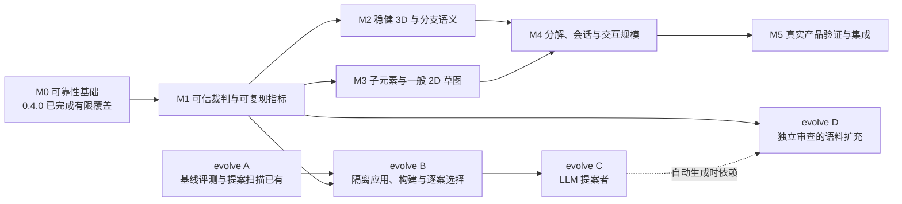

# 演进路线与验收门

本路线以 **0.4.0 / `51d18d4` / 2026-10-13** 为基线。目标是先把 **3D 装配、可信诊断、可嵌入核心** 做到可用于真实产品，再扩展一般 2D 草图、交互规模和 CAD 集成。阶段按依赖和证据推进；它们不是按日期自动兑现的功能清单，也不承诺在某个时间点达到商业求解器的全部覆盖范围。

导航：[文档索引](README.md) · [架构](architecture.md) · [ADR](adr/README.md) · [产品说明](../README.md) · [实验区说明](../evolve/README.md)

## 基线与边界

0.4.0 已完成第一轮数值可靠性修复：有界角度折回、SVD 迭代预算、非有限输入检查、保守无解诊断、方向与零角约束语义、局部 SO(3) 更新、列尺度均衡、2D 回灌幂等，以及独立几何检查和对应反例。

该版本的本地验证记录为 **101 项产品测试、21 项评测器测试、25 个黄金案例、4 组数值 parity 夹具（case3—case6）**。这是发布快照的数据，不是未来测试数量的硬编码要求；也不能据此断言某次远端 CI 的全部架构已经通过。跨平台状态应以对应提交的 CI 结果为准。

当前证据入口：

| 领域 | 可查验材料 | 仍需补齐的证据 |
|---|---|---|
| 数值回归与输入校验 | [regression_test.rs](../crates/ansatz-core/tests/regression_test.rs)、[input_validation_test.rs](../crates/ansatz-core/tests/input_validation_test.rs) | 更广泛的退化、尺度、多初值和长期轨迹 |
| 独立几何审查 | [geometry_check.rs](../evolve/crates/evaluator/src/geometry_check.rs)、[geometry_oracle.rs](../evolve/crates/evaluator/tests/geometry_oracle.rs) | 独立的 DOF、全局可行性及诊断证据；更广泛约束覆盖 |
| 公共黄金行为 | [corpus/cases](../evolve/corpus/cases)、[语料契约](../evolve/corpus/README.md) | 生成集、真实模型留出集、性能与轨迹集 |
| 位级数值输出 | [parity_test.rs](../crates/ansatz-core/tests/parity_test.rs)、[夹具目录](../crates/ansatz-core/tests/parity) | 未来算法与分解后端对应的跨平台覆盖 |
| 发布质量门 | [ci.yml](../.github/workflows/ci.yml) | 固定硬件性能门、扩展失效预算、兼容性回放 |

当前 DOF 是返回位形处局部雅可比的一阶秩信息；独立检查器验证几何满足度，并不证明非线性系统的全局可解性。`inconsistent` 的现有直接证明范围有限。一般 2D 草图、连续关节绕转、增量拖拽、稀疏求解和自动提案应用尚未实现。公共语料通过率不能替代泛化能力评估。

## 依赖路线

图中的依赖表示验收前置条件，不要求所有开发严格串行。M2 与 M3 可以并行研究，但小团队优先投入 M1、M2；M4 的交互验收应分别针对已经支持的 3D 或 2D 场景进行，避免由未完成的功能掩盖已有领域的性能问题。

## M0：可靠性基础——已完成首轮，持续守门

**交付已完成：** 修复已知挂死、误报无解、约束语义与 DOF 反例；建立完整报告校验、独立几何检查、数值回归和回灌幂等验证。

**必须保留的门槛：** 原始反例可复现；合法的大有限角度不会进入减 `2π` 的永久循环；已知可行驻点失败返回 `not_converged`；同向、归一化、零滚转与等价全转姿态的语义明确；伪造收敛和不完整报告不能通过评测。

**边界：** 已知挂死路径修复不等于已经证明所有输入均在总资源预算内完成。后续仍需覆盖异常规模、内存、I/O、子进程树与构建资源限制。

**持续证据：** 上表回归文件、黄金案例与对应版本 CI。新增反例先加入测试并保留最小模型，再修改算法；不能通过删除失败案例或扩大容差消除回归。

## M1：可信裁判、数据集与指标——计划

建设顺序：

1. 定义声明支持的几何领域、单位与容差契约，为每个案例标注类别、可行性证据、初值策略和预期诊断强度。
2. 建立固定种子的生成测试与变形测试：几何等价旋转、刚体变换、单位换算、实体与约束重排、多初值，以及临近退化位形。每类变换按契约检查，避免把任意特解或输出顺序误当几何唯一性。
3. 收集真实模型并冻结留出集。训练或提案过程可见集、回归集、留出集分开；模型来源、授权、规范化方式和泄漏风险有记录。
4. 扩展独立裁判的故障注入：残差造假、缺失实体、关节变量错误、固定体漂移、重复或错配 ID、挂住候选与空语料。新增约束先明确数学语义，再用独立计算方式补检查。
5. 建立性能与失效报告：记录代码、二进制、语料、工具链、运行配置、硬件和固定种子；性能测量单独处理可变的计时数据，不破坏当前确定性谱系格式。

**退出门：** 所有 `converged` 输出在声明支持领域内通过独立几何检查；已知可行集没有错误的 `inconsistent`；每个失败都能从模型、种子和版本重放；故障注入中的伪造报告与违规候选全部被拒绝；计时已区分内核、诊断、JSON 和进程开销。尚无独立证据的 DOF 或冲突断言必须标明其来源，不能用候选自身结论作真值。

## M2：稳健 3D、闭链与诊断证据——计划

在现有局部 SO(3) 更新和列均衡上继续建设，而不是再次把它们列为待实现功能。

- 扩展尺度和容差设计，分别处理平移、角度、关节变量及各类残差；引入条件谱、秩阈值敏感性与诊断可信度。近奇异位形要区分机构自由度、一阶退化和数值不可辨识。
- 比较信赖域、阻尼与退化初值恢复策略。策略切换需有确定规则，并用失败样本证明改进；所有尝试有迭代、时间与资源预算。
- 建立闭链、多解与装配分支语义；明确用户选定分支、初值偏好、连续驱动与跨 `π` 轨迹的行为。
- 将当前模 `2π` 的关节/传动关系与未来连续绕转状态分开设计。绕转数、传动相位和轨迹回放属于显式状态，不能从一次输入位姿暗中推导历史。
- 扩展冲突证明与可验证修复建议。局部秩和多次失败只能提供疑似冲突信息；只有满足明确证明条件才输出 `inconsistent`。

**退出门：** 冻结的闭链、尺度、多初值与近奇异集合全部有分类结果；几何等价表示不改变正确诊断；直接证明无解的案例有可审查证据；连续轨迹的分支跳变和绕转行为可统计、可重放。若无法判断，返回明确的未收敛或低可信诊断，保留失败证据，不把数值困难升级为数学矛盾。

## M3：一般 2D 草图——计划

先完成模型表达，再增加约束枚举：

1. 子元素引用、参数布局、工作平面与稳定 ID；明确线段端点、圆心、圆弧端点等如何参与约束，保证 JSON、Schema、类型定义和错误映射同步。
2. 点、线段、圆、圆弧的几何表示及退化规则；分批实现重合、水平/垂直、距离、角度、平行、垂直、相切、半径、等长与固定等标准约束。
3. 明确驱动尺寸与参考尺寸、方向或符号选择、欠约束移动偏好；为每类约束补解析导数验证、独立几何审查和真实草图流程。

**退出门：** 用完整机械草图流程验收创建、改尺寸、欠约束位形编辑、冗余解释与冲突修复；实时拖拽延迟和连续性放在 M4 验收。支持矩阵明确列出已实现、退化限制和不支持项。实体类型存在或 Schema 接受输入不能作为功能已支持的证据。每个新增约束必须同时有独立检查与黄金行为。

## M4：交互与规模——计划

- 约束图连通分解、刚性子结构消元与局部诊断；先消除重复全局分解，再选择稀疏后端。
- 设计 `CompiledModel` 与显式 `Session`：编译后的拓扑、缓存失效、初始或上次状态、分支选择和预算都可记录。保留一次性 `solve` 接口与纯函数路径，壳继续只做转换与错误映射。
- 实现局部增量更新、拖拽目标、轨迹采样和取消；把编译、求解、诊断的成本分别测量，避免零迭代仍为全局冗余分析支付高代价。
- 为图排序、稀疏消元、枢轴和并列值制定确定规则。后端选择必须通过 `no_std`、平台构建、Schema、行为与位级 parity；有意改变数值策略时审查并再生成基准位模式。

**退出门：** 固定参考硬件与模型类别上建立规模曲线；拖拽轨迹可回放且分支行为符合契约；缓存命中和失效可验证；性能改善不牺牲诊断与几何正确性。并行或稀疏方案不能通过关闭确定性要求获得成绩。

## M5：真实产品验证、兼容性与集成——计划

围绕真实使用场景建立版本兼容回放、错误恢复、支持矩阵与发布证据。算法升级同时报告正确性、诊断变化、轨迹行为与性能；契约变更有 ADR、迁移说明和版本策略。

未来 CAD 适配遵循 [AGENTS.md 的 PDR-1](../AGENTS.md)：**Onshape 优先**。实施时重新核验 API、权限、版本与服务限制；把其 mate/feature 语义作为适配层语义，不把外部平台包装当作 Ansatz 数学真值。集成与 OHOS 专项按实际用户需求排期，核心可靠性与主流平台质量门优先。

不等式与关节限位、样条、螺旋副、URDF 等按真实需求进入独立提案。每项都需要语义、算法、诊断、独立裁判和维护成本评估；不因功能列表较长就扩展当前承诺。

**退出门：** 明确场景中有长期真实模型回放和公平对比材料；同一输入、版本、配置可复现；用户可理解支持边界和迁移成本。商业级覆盖是逐领域积累的结果，不能仅凭公共语料满分或单次性能结果宣布完成。

## evolve 并行路线

| 阶段 | 当前状态与依赖 | 验收要求 |
|---|---|---|
| A：人工提案模式 | 已有基线黑盒评测、`baseline` 谱系追加、按文件名排序扫描 patch；[入口源码](../evolve/crates/harness/src/main.rs)仅列出待处理提案 | 保持完整报告、独立几何、超时和两次输出一致检查；人工应用和构建仍在循环之外 |
| B：自动应用、构建、评测 | 计划；依赖 M1 的可信裁判与可追溯性 | 隔离工作目录，限制构建与运行资源、I/O 和子进程；裁判/语料只读且不由候选替换；记录源码与二进制哈希；候选逐 case 不退化，并通过产品 CI 门 |
| C：LLM 提案者 | 计划；已有供应商无关 `Proposer` trait，依赖 B | 限制修改范围与预算；提案提供反例、原理和验证证据；失败与拒绝也归档，不能通过修改评分标准晋级 |
| D：语料扩充 | 计划；依赖 M1，若由 LLM 自动生成还依赖 C | 候选生成模型不等于模型真值；独立 oracle 或构造证明审查后才纳入；真值变更独立审核并版本化，保留原始回归与留出集 |

当前 [ThresholdSelector](../evolve/crates/harness/src/lib.rs)只比较总体 `pass_rate`；阶段 B 必须升级到逐案例回归比较，防止一个修复抵消另一个退化。当前 subprocess + timeout 也不是完整操作系统资源隔离。二进制版本字符串和现有语料哈希不足以唯一识别候选，B 需补代码与产物摘要。

阶段 C、D 的提案者不能自行放松容差、删失败案例、修改裁判或用自己的求解结果为新案例背书。确需改变契约或真值时，将其作为独立且可审查的变更处理。

## 量化目标：拟定门槛，非当前成绩

所有比例都需附带领域、分母、版本、配置与数据集。以下目标待 M1 建立测量基础后冻结；没有测量环境时不能当作外部产品对比结果。

| 指标 | 建议门槛 | 测量边界 |
|---|---|---|
| 收敛结果正确性 | 声明支持领域内，`converged` 输出 **100%** 通过独立几何检查 | 检查器覆盖范围与容差契约必须公开 |
| 无解误报 | 已知可行冻结集合中错误 `inconsistent` 为 **0** | 可行性须有独立证据；未知问题单列 |
| 可行问题成功率 | 冻结标准集拟定 **≥99.9%** | 按类别和初值分别报告，不能只报总体平均 |
| 数据覆盖 | 拟定不少于 **10,000** 个可追溯案例 | 生成、真实、留出、轨迹集合分开，数量不等于多样性 |
| 交互延迟 | 拟定常见 **100 实体**模型局部更新 **p95 <16 ms** | 固定硬件、类别、求解预算；内核、诊断、JSON、端到端分开计时 |
| 预算与失效 | 超时、内存/输出限制、迭代耗尽均有分类结果 | 每个失效保留最小模型、种子、代码与二进制摘要 |
| 轨迹稳定性 | 分支跳变、绕转连续性与取消响应均有统计 | 声明所选分支及允许切换条件，使用固定轨迹回放 |
| 确定性与兼容 | 对应平台矩阵 parity、JSON 往返、回灌幂等和历史模型回放通过 | 版本内逐位一致与版本间行为兼容分别验收 |

## 优先 backlog 与失败退出机制

| 顺序 | 下一项可交付任务 | 依赖 | 验收证据存放位置 |
|---|---|---|---|
| P1 | 冻结支持矩阵、单位/容差契约和失败分类 | M0 | `docs/` 说明、`docs/adr/` 决策及版本化 Schema |
| P2 | 固定种子生成器与变形测试；补独立裁判故障注入 | P1 | 产品回归测试、评测器测试、新语料及生成说明 |
| P3 | 真实留出集清单、可行性来源和回放工具 | P1 | 单独版本化数据集 manifest 与评测报告；受限数据记录可访问来源 |
| P4 | 分层性能基准、规模曲线、失效预算 | P2 | 版本化基准模型、配置及 CI 产物；拟新增基准入口，当前尚无固定硬件门 |
| P5 | 闭链、近奇异秩与连续关节/分支方案 | P2、P3 | ADR、最小反例、轨迹集及逐类评测 |
| P6 | 图分解和冗余分析成本改善；设计 `CompiledModel`/`Session` | P4、P5 | 性能前后报告、缓存失效测试与平台 parity |
| P7 | 子元素引用和工作平面；分批扩展 2D | P1、P2，按团队容量启动 | ADR、Schema、约束支持矩阵、独立检查与真实草图回放 |
| P8 | evolve B 自动循环 | P2、P4 | 隔离与故障注入测试、逐 case 比较、包含代码/产物摘要的谱系 |

每个任务在开始前明确修改范围、成功指标和预算。预算耗尽或退出门失败时保留可复现证据，拒绝候选或缩小明确支持范围；不得以“已尝试多次”替代证明、以总分掩盖退化，或为赶阶段日期放松裁判。新增重大取舍记录 ADR，阶段状态随证据更新。

团队容量决定并行度与排期。若只有一至两名核心开发者，先完成 M1 与 3D 可靠性，再启动一般 2D 和集成；三至五名具备数值计算/CAD 经验的工程师可并行推进裁判、3D 与模型设计，但真实样本获取和算法风险仍决定工期。按完成的退出门规划发布，避免用固定月份承诺“顶级”水平。
